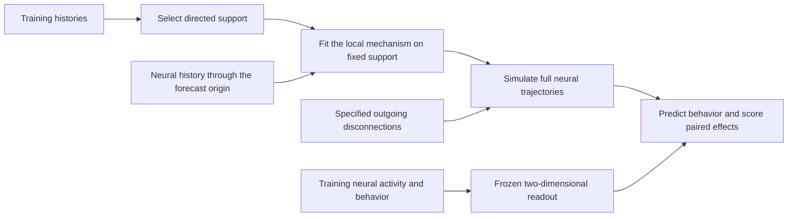

# Effectome mechanism rollout

The working pipeline estimates how interactions among neurons shape their future
activity, then decodes those simulated trajectories into behavior. Notebook 10's
development run motivates this choice. With a 1,024-sample history, the local
mechanism reduced driver-switch forecast MAE from **0.2040** for the pooled
static mechanism to **0.1786** across five seeds. The oracle reached **0.1784**.
MAE for oracle-active interventions fell from **0.0894** to **0.0167**. Graph
features added little to the direct forecast regression at this history length.
[Notebook 10 results](../outputs/behavior-transition/development/recurrent-coupling-01/analysis-report.md) · [Experiment design](behavior_supervised_transition_plan.md#development-results)

## Working pipeline

The fresh-seed comparison below favors a training-selected support mask with a
local refit. This is the simplest candidate to carry forward. Updating the mask
at each origin remains a sensitivity analysis. The fresh-seed forecast decision
failed for the dynamic-support fit. The fixed-support comparison is descriptive.



1. **Fit and freeze the behavioral readout.** Train the two-dimensional
   behavior-only encoder on designated training trials. Reuse its frozen
   parameters for every forecast and perturbation. [Notebook 09 readout design](behavior_supervised_experiment_plan.md)
2. **Estimate the effectome up to the forecast origin.** Select directed
   lag-one support with fast c-GC using training histories. Keep the mask fixed
   and refit the additive tanh mechanism on the trailing window at each origin.
   The local fit estimates signed cross-neuron coefficients, linear
   self-history, and residual-based innovation scales.
   [Native estimator provenance](four_csl_migration.md) · [Mechanism assumptions and references](driver_methodology_revision.md)
3. **Roll the mechanism forward and decode.** Start from the last observed
   neural state. Simulate the full neural state using the origin's fitted
   mechanism. Apply the frozen readout to each simulated step before averaging
   behavior over the target interval and across draws. For a behavioral-change
   forecast, subtract the observed origin behavior from that mean.
4. **Estimate effects of specified outgoing disconnections.** Repeat the
   rollout with the specified outgoing cross-neuron terms zeroed, retaining
   self-history and incoming effects to those neurons. Pair each draw with its
   factual draw using the same initial state and innovations. Report the
   factual mean minus the disconnected mean in behavioral units.
   [Intervention definition and assumptions](driver_methodology_citation_audit.md#verified-references-and-supported-claims)

The path needs one native estimator, one mechanism family and one frozen
readout. [The reusable rollout workflow](../src/effectome/workflows/effectome_rollout.py)
simulates signed fitted mechanisms using a frozen readout. The [standalone
runner](../synthetic/effectome_rollout.py) executes the fixed-support fit and the
validation comparisons. Notebook 10 records the graph regression and
feature-omission development trials. Use its existing artifacts when reviewing
those comparisons, or give a new fit a new run label so its source fingerprint
has a matching output namespace.

## Focused synthetic validation

Each condition uses 32 trials, with 10 for readout fitting, 14 for the pooled
mechanism reference and eight for evaluation. Every evaluated origin ends a
1,024-sample history at 10 Hz. The target averages steps five through eight.
Each origin uses 128 paired innovation draws. The simulator provides one
driver-switch condition and two controls with constant coupling or a switch in
nuisance coupling only. All lanes use the same test origins, target window and
innovation draws. The estimated lanes share the frozen behavioral readout.

| Lane | Directed support | Signed coefficients |
|---|---|---|
| Local mechanism | Discovered on the origin's trailing history | Fitted on that history |
| Pooled reference | Consensus of the pooled-reference histories | One fit across those histories |
| Fixed-support local fit | The pooled reference's exact support | Fitted on the origin's trailing history |
| Oracle | Simulator support | Simulator coefficients |

The fixed-support local fit tests how much of the rollout gain comes from
adapting the mechanism parameters under one support mask. The intercept,
self-history, cross-neuron coefficients and residual scales all use the local
history. Comparing both local fits measures the additional value of
rediscovering support at each origin while holding the fitting data and rule
fixed. These comparisons are descriptive diagnostics. The oracle serves as a
simulator benchmark.

The confirmation's primary contrast is the pooled reference's forecast MAE
minus the local mechanism's forecast MAE, computed once per independent seed
in each condition. It requires gains above **0.005 MAE** in the driver-switch
condition and below **0.005 MAE** in each control. All three one-sided exact sign
tests must pass at 0.05. Values equal to the margin count against the required
direction. Intervention errors are reported separately on the same origins,
including on oracle-active effects. The control tests assess the specificity of
forecast gains.

Run from the application repository with the existing fast c-GC and behavior
encoder environments. The smoke profile uses seed 83000. The confirmation
profile uses 20 independent seeds from 84000 through 84019.

```sh
.venv/bin/python -m synthetic.effectome_rollout --profile smoke --run
.venv/bin/python -m synthetic.effectome_rollout --profile confirmation --run
.venv/bin/python -m synthetic.effectome_rollout --profile confirmation --status
```

Outputs go to `outputs/effectome-rollout/<profile>/mechanism-rollout-01/`. The
profile records seed-level forecast and intervention errors alongside the saved
run evidence. See the [estimator installation](../README.md#install) and
[encoder runtime](../tools/behavior-encoder/README.md) for setup.

The validation addresses forecasting and modeled intervention effects within an
established regime in a fully observed synthetic circuit. The experiment starts
after a full within-regime history. Forecasting close to a coupling switch and
estimating causal effects from biological recordings remain open questions.

## Fresh-seed result and decision

All 60 cases completed. The audit verified 180 artifact hashes and recomputed
the forecast errors and decisions. The dynamic-support rollout lowered the average driver-switch MAE from
0.21886 to 0.20217. Twelve of 20 seeds exceeded the 0.005 gain margin, short of
the 15 required by the frozen test. Both control gates passed. The complete
forecast decision was a fail.

The fixed-support local fit averaged 0.20175 on driver-switch forecasts and
0.01515 on oracle-active intervention effects. The corresponding values for the
local dynamic-support fit were 0.20217 and 0.01837. These descriptive contrasts
favor local adaptation with a fixed mask as the next candidate. The pooled fit
was slightly more accurate on both control forecasts and on active control
interventions. A prospective comparison should test when local adaptation is
warranted, with the pooled reference available for stable histories. It should
also measure performance as a function of elapsed time after a coupling switch.
[Audited confirmation results](../outputs/effectome-rollout/confirmation/mechanism-rollout-01/review/analysis-report.md) · [Post-switch timing design](effectome_rollout_timing.md)
